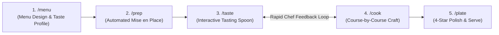

# 👨‍🍳 `shikamaru-kitchen` — The Michelin-Star Software Kitchen (v1.0)

> *"Build a Michelin-star kitchen, not a software factory. Automate the repetitive prep work (mise en place) so the human Head Chef can focus on iteration, taste, polish, and architectural craft."*
> — Inspired by **Cillian Myles** (*Idiomatic Bytes*) & **Lauren Tan** (*Mechanical Codebase Guardrails*)

---

## 🌟 Why `shikamaru-kitchen` Exists

Most AI coding workflows fall into two traps:
1. **The Unattended "Software Factory" Trap:** Dumping a high-level prompt into an autonomous agent swarm and getting thousands of lines of generic "AI Slop" that technically compiles (`tsc --noEmit`) but lacks product taste, coherent UX, or idiomatic architecture.
2. **The Manual Artisan Bottleneck:** Hand-coding every boilerplate CRUD route, migration, and test yourself, moving too slowly to iterate on what actually matters.

**`shikamaru-kitchen`** solves both by modeling software engineering after a **3-Michelin-Star Culinary Brigade**:
- **Obsessive *Mise en Place* (`/prep`):** AI Prep Cooks automate 100% of the repetitive drudgery (scaffolding, DB plumbing, auth guards, and 0-token Mechanical Architecture Linters) so every station is spotless before service begins.
- **The Tasting Spoon First (`/taste`):** You never cook a 1,500-line feature blindly from a static text spec. `/taste` generates an interactive, playable HTML/UI Tasting Prototype (`preview.html` / `<agent-embed>`) in under 60 seconds so you can *feel* the UX, adjust the flavor, and only lock the recipe (`design.md` + `courses.md`) once it tastes right.
- **Course-by-Course Station Craft (`/cook`):** Features are cooked in small, verifiable **Courses** (Course 1: Domain & Unit Tests → Course 2: Core Interactive UX → Course 3: Micro-Interactions & Edge-Case Seasoning).
- **Michelin Plating & Chef Pass (`/plate`):** Every dish must pass **Food Safety** (0-token mechanical architecture linters, strict types, unit/E2E tests) **AND** the **4-Star Culinary Craft Audit** (micro-states, zero layout shift, empathetic copy, `< 250-line` idiomatic components) with real browser evidence (`evidence/*.png`) before the Head Chef serves it to `main`.

---

## 🔄 The 5-Stage Culinary Lifecycle



| Command | Culinary Stage | What Happens | Output Artifacts |
| :--- | :--- | :--- | :--- |
| **`/menu`** | **1. Menu Design & Taste Profile** | Interactive session with the Executive Chef to define **Signature Dishes** (core differentiating UX) vs. **House Staples** (plumbing), aesthetic direction, and the **Anti-Slop Manifesto**. | `AGENTS.md`, `docs/foundation/{menu-vision,architecture,taste-system}.md`, `docs/planning/service-board.md` |
| **`/prep`** | **2. Automated *Mise en Place*** | AI Prep Cooks scaffold the repo, configure design tokens, set up CI, and install the **0-token Mechanical Architecture Linter** (`architecture.test.ts` / `test_architecture.py` / `HexagonalArchitectureTest.php`). | `docs/dishes/00-prep/`, clean compiling base app + mechanical boundary tests |
| **`/taste`** | **3. The Tasting Spoon** | Generates an interactive HTML/UI Tasting Prototype (`design-reference/preview.html` + inline `<agent-embed>`) showing Happy, Empty, Loading, and Error states *before* writing production code. Locks EARS recipe criteria once approved. | `docs/dishes/<NN-dish-slug>/{recipe,design,courses,plating}.md` + `design-reference/preview.html` |
| **`/cook`** | **4. Course-by-Course Station Craft** | Implements the dish across 3 structured Courses (Domain Engine → Interactive UI → Edge-Case Seasoning) with atomic git checkpoints and live tasting pauses. | Verified production code + unit/invariant tests |
| **`/plate`** | **5. Michelin Plating & Serve** | Runs Food Safety (types, tests, mechanical linter) + **4-Star Culinary Craft Audit** + real browser proof (`evidence/*.png`), waits for the Head Chef's final nod, and serves (commits/PRs). | `docs/dishes/<NN-dish-slug>/evidence/*.png`, updated `service-board.md`, clean Git PR |

---

## 🗺️ Repository Structure

| Path | Purpose |
| :--- | :--- |
| [`INVENTORY.md`](INVENTORY.md) | Catalog of active stack packs, culinary lifecycle skills, and golden recipe templates |
| [`core/rules/kitchen-protocol.md`](core/rules/kitchen-protocol.md) | Always-on Brigade Guardrails: *Mise en Place*, Tasting Spoon First, Anti-Slop Craft Rules, 3-Strike Rule |
| [`core/skills/menu/`](core/skills/menu/SKILL.md) | **`/menu`** — Concept, Signature Dish vs. Staple triage, and Taste System generator |
| [`core/skills/prep/`](core/skills/prep/SKILL.md) | **`/prep`** — Automated *Mise en Place*, base scaffolding, and Mechanical Architecture Linter setup |
| [`core/skills/taste/`](core/skills/taste/SKILL.md) | **`/taste`** — Interactive Tasting Spoon prototyper (`preview.html`) & EARS Recipe specification |
| [`core/skills/cook/`](core/skills/cook/SKILL.md) | **`/cook`** — 3-Course guided implementation engine with golden stack templates |
| [`core/skills/plate/`](core/skills/plate/SKILL.md) | **`/plate`** — Food Safety verification + 4-Star Culinary Craft Audit + Browser Evidence & Serve |
| [`stacks/nextjs-supabase/`](stacks/nextjs-supabase/) | Next.js 15+ · React 19 · TypeScript · Supabase · Vercel AI SDK stack pack |
| [`stacks/python-fastapi/`](stacks/python-fastapi/) | Python 3.12+ · `uv` · FastAPI · Pydantic v2 · Pytest stack pack |
| [`stacks/wp-hexagonal/`](stacks/wp-hexagonal/) | WordPress Hexagonal Modular Monolith (PSR-4, Ports & Adapters, Pure Domain, React/TS Admin) stack pack |
| [`scripts/sync-kitchen.ps1`](scripts/sync-kitchen.ps1) | Syncs the `shikamaru-kitchen` `.agents/` engine into any target project (also available in Bash: `scripts/sync-kitchen.sh`) |
| [`scripts/eval-kitchen.ps1`](scripts/eval-kitchen.ps1) | Automated 5-Suite Kitchen Quality & Integrity Eval (`scripts/eval-kitchen.sh`) |

---

## 🚀 Quick Start

### 1. Sync the Kitchen Engine into a Target Project
```powershell
# PowerShell (Windows)
.\scripts\sync-kitchen.ps1 -ProjectPath "..\my-crafted-app" -Stack "nextjs-supabase"
```
```bash
# Bash (macOS / Linux)
bash scripts/sync-kitchen.sh ../my-crafted-app nextjs-supabase
```

### 2. Run the Culinary Workflow in Your AI IDE (Antigravity, Claude Code, Cursor, Codex, Windsurf)
1. **`/menu`** — Design your product menu, signature dishes, and taste system.
2. **`/prep`** — Let the AI Prep Cooks set up *mise en place* and mechanical architecture guardrails.
3. **`/taste 01-signature-feature`** — Taste the interactive UI prototype first and lock the recipe.
4. **`/cook 01-signature-feature`** — Cook Course 1 (Domain), Course 2 (Interactive UI), and Course 3 (Seasoning).
5. **`/plate 01-signature-feature`** — Run the 4-Star Culinary Craft Audit, inspect browser proof, and serve!

### 3. Verify Kitchen Integrity (`eval-kitchen`)
```powershell
.\scripts\eval-kitchen.ps1
```
