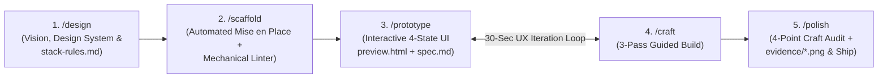

# 👨‍🍳 `shikamaru-kitchen` — Michelin-Grade Software Craft Engine (`v1.0`)

> *"Build a Michelin-star kitchen, not a software factory. Automate the repetitive prep work (mise en place) so the human engineer can focus on interactive prototyping, iteration, taste, polish, and architectural craft."*
> — Inspired by **Cillian Myles** (*Idiomatic Bytes*) & **Lauren Tan** (*0-Token Mechanical Codebase Guardrails*)

---

## 🌟 Why `shikamaru-kitchen` Exists

Most AI coding workflows fall into two traps:
1. **The Unattended "Software Factory" Trap:** Dumping a high-level prompt into an autonomous agent swarm and getting thousands of lines of generic "AI Slop" that technically compiles (`tsc --noEmit`) but lacks product taste, coherent UX, or idiomatic architecture.
2. **The Manual Artisan Bottleneck:** Hand-coding every boilerplate CRUD route, migration, and test yourself, moving too slowly to iterate on what actually matters.

**`shikamaru-kitchen`** solves both by modeling software engineering after a **3-Michelin-Star Kitchen**—using real, production-grade software engineering commands:
- **Automated *Mise en Place* (`/scaffold`):** AI automates 100% of the repetitive drudgery (base project setup, design tokens, CI, and a dynamically generated **0-Token Mechanical Architecture Linter**) so your codebase is spotless before feature work begins.
- **Interactive 4-State Prototype First (`/prototype`):** You never build a 1,500-line feature blindly from a static text spec. `/prototype` generates a playable HTML/UI prototype (`design-reference/preview.html` + inline `<agent-embed>`) showing `✨ Happy`, `🌱 Empty`, `⏳ Zero-CLS Skeleton`, and `🛟 Error Recovery` states in under 60 seconds so you can *feel* and tweak the UX before locking `docs/specs/<NN-feature>/spec.md`.
- **3-Pass Guided Implementation (`/craft`):** Features are built in 3 incremental, verifiable **Passes** (Pass 1: Domain & Unit Tests → Pass 2: Core Interactive UX → Pass 3: Micro-Interactions & Keyboard Ergonomics).
- **4-Point UX & Code Craft Audit (`/polish`):** Every feature must pass **Mechanical Safety** (0-token mechanical architecture linter, strict types, unit/E2E tests) **AND** the **4-Point UX & Code Craft Audit** (micro-states/zero CLS, empathetic copy, keyboard flow, `< 300-line` idiomatic components) with real browser evidence (`evidence/*.png`) before shipping.

---

## 🔄 The 5-Stage Software Craft Lifecycle



| Command | Stage | What Happens | Output Artifacts |
| :--- | :--- | :--- | :--- |
| **`/design`** | **1. Vision, Design System & Architecture** | 4-round alignment to define **Signature Craft Features** (`✨ SIGNATURE CRAFT`) vs. **Plumbing** (`⚙️ PLUMBING`), aesthetic direction, the **Anti-Slop Craft Manifesto**, and auto-tailored `stack-rules.md` (`<= 80` lines). | `AGENTS.md`, `docs/foundation/{prd,architecture,design-system}.md`, `docs/planning/roadmap.md` |
| **`/scaffold`** | **2. Automated *Mise en Place*** | Scaffolds the base repo, configures design tokens & CI, and dynamically generates the **0-Token Mechanical Architecture Linter** (`architecture.test.*`). | `docs/specs/00-scaffold/spec.md`, compiling base app + `< 50ms` mechanical boundary tests |
| **`/prototype`** | **3. Interactive 4-State UI Prototype & Spec** | Generates an interactive 4-state HTML/UI prototype (`design-reference/preview.html` + inline `<agent-embed>`) *before* writing production code. Locks 1 unified `spec.md` (`~72` lines) once approved. | `docs/specs/<NN-feature-slug>/spec.md` + `design-reference/preview.html` |
| **`/craft`** | **4. 3-Pass Guided Implementation** | Implements the feature across 3 structured Passes (Pass 1: Domain Engine & Unit Tests → Pass 2: Core Interactive UI → Pass 3: Micro-Interactions & Keyboard Ergonomics) with atomic git checkpoints. | Verified production code + unit/invariant tests |
| **`/polish`** | **5. 4-Point Craft Audit & Ship** | Runs Mechanical Verification + **4-Point UX & Code Craft Audit** + real browser proof (`evidence/*.png`), awaits human sign-off on Signature Craft features, and ships. | `docs/specs/<NN-feature-slug>/evidence/*.png`, updated `roadmap.md`, clean Git commit/PR |

---

## 🗺️ Repository Structure

| Path | Purpose |
| :--- | :--- |
| [`.agents/rules/kitchen-protocol.md`](.agents/rules/kitchen-protocol.md) | Always-on Craft Guardrails: *Mise en Place*, Interactive Prototype First, 3-Pass Build Loop, 4-Point Craft Audit, 3-Strike Rule |
| [`.agents/skills/design/`](.agents/skills/design/SKILL.md) | **`/design`** — Product Vision, Signature Craft vs. Plumbing triage, Design System & auto-tailored `stack-rules.md` (`<= 80` lines) |
| [`.agents/skills/scaffold/`](.agents/skills/scaffold/SKILL.md) | **`/scaffold`** — Automated *Mise en Place*, base scaffolding, and Dynamic 0-Token Mechanical Architecture Linter Generator |
| [`.agents/skills/prototype/`](.agents/skills/prototype/SKILL.md) | **`/prototype`** — Interactive 4-State UI Prototyper (`preview.html`) & Unified EARS `spec.md` |
| [`.agents/skills/craft/`](.agents/skills/craft/SKILL.md) | **`/craft`** — 3-Pass guided implementation engine |
| [`.agents/skills/polish/`](.agents/skills/polish/SKILL.md) | **`/polish`** — Mechanical Verification + 4-Point UX & Code Craft Audit + Browser Evidence & Ship |
| [`.agents/templates/`](.agents/templates/) | Universal Stack-Agnostic Starter Templates (`AGENTS.md.template`, `stack-rules.md.template`, `CLAUDE.md.template`) |
| [`scripts/sync-kitchen.ps1`](scripts/sync-kitchen.ps1) | Syncs the universal `shikamaru-kitchen` `.agents/` engine into any target project (`scripts/sync-kitchen.sh` for Bash) |
| [`scripts/eval-kitchen.ps1`](scripts/eval-kitchen.ps1) | Automated 4-Suite Universal Software Craft Integrity Eval (`scripts/eval-kitchen.sh`) |

---

## 🚀 Quick Start

### 1. Sync the Universal Engine into Any Target Project (Any Tech Stack)
```powershell
# PowerShell (Windows)
.\scripts\sync-kitchen.ps1 -ProjectPath "..\my-crafted-app"
```
```bash
# Bash (macOS / Linux)
bash scripts/sync-kitchen.sh ../my-crafted-app
```

### 2. Run the 5-Stage Software Craft Workflow in Your AI IDE
1. **`/design`** — Define your product vision, Signature Craft features, Design System, and `stack-rules.md`.
2. **`/scaffold`** — Automate *mise en place* and generate your 0-token Mechanical Architecture Linter.
3. **`/prototype 01-signature-feature`** — Test-drive the interactive 4-state UI prototype first and lock `spec.md`.
4. **`/craft 01-signature-feature`** — Build Pass 1 (Domain), Pass 2 (Interactive UI), and Pass 3 (Micro-Interactions & Ergonomics).
5. **`/polish 01-signature-feature`** — Run the 4-Point UX & Code Craft Audit, inspect browser proof (`evidence/*.png`), and ship!

### 3. Verify Engine Integrity (`eval-kitchen`)
```powershell
.\scripts\eval-kitchen.ps1
```
